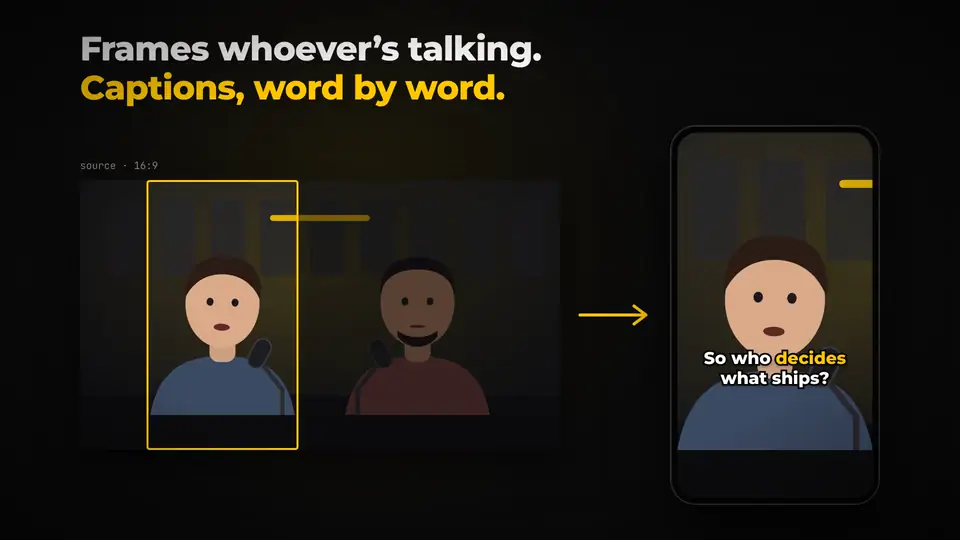

<div align="center">

# 🎙️ AI Podcast Short Editor

**One command turns a long podcast video into branded vertical shorts with word-by-word captions.**

Point it at a Google Drive link or a local file. It transcribes the whole episode, has Claude pick the moments
that stand on their own, frames whoever is talking in 9:16, burns in Mindera-styled karaoke captions, and hands back
ready-to-post `.mp4`s, covers and copy.

`Python 3.12` · `uv` · `ffmpeg` · `faster-whisper` · `OpenCV YuNet` · `Claude Code (claude -p)` · `macOS-friendly, no sudo`

</div>

<p align="center">
  <a href="docs/media/demo.mp4"></a>
  <br>
  <sub>🔊 <a href="docs/media/demo.mp4">Watch with sound</a> · made with <a href="https://github.com/latent-spaces/brag">/brag</a></sub>
</p>

```bash
./shorts "https://drive.google.com/file/d/<FILE_ID>/view" --host "Ana Silva" --guest "Rui Costa" --clips 8
# → ~/Shorts/<short-filename>/01_<slug>.mp4  01_<slug>.jpg  01_<slug>.ass  …  README.md  _qa/contact_sheet.jpg
```

---

## Contents

- [What it does](#-what-it-does)
- [Quick start](#-quick-start)
- [Running it from an AI assistant](#-running-it-from-an-ai-assistant)
- [The commands at a glance](#-the-commands-at-a-glance)
- [Making shorts](#-making-shorts)
- [Configuration](#-configuration)
- [How it works](#-how-it-works)
- [Outputs](#-outputs)
- [Install and dependencies](#-install-and-dependencies)
- [Development](#-development)
- [Known limits and assumptions](#-known-limits-and-assumptions)
- [Licence](#-licence)

---

## ✨ What it does

Cutting shorts from a 1-hour episode means scrubbing the whole thing, guessing at good moments, reframing each one,
and typing captions. This tool does all of that from one command and stops once, so you can approve the picks.

| | |
|---|---|
| 🧠 **Claude picks the moments** | Headless `claude -p` reads the **whole** transcript and chooses clips that make sense without context: a hook in the first 3 s, 20–60 s long (never over 90 s), starting and ending on complete thoughts. It skips the cold-open teaser, bios and intros. It uses your existing Claude Code login, so no API key is needed. |
| ✋ **One approval stop** | Before anything is rendered you get a ranked table (score, start, length, title, opening line), clips over 60 s with a suggested shorter cut, 3–4 runners-up, and the caption corrections. Type `go`, or edit `clips.json` first. `--yes` skips the stop. |
| 🎯 **Frames whoever is talking** | YuNet face detection at 10 fps, shot-cut detection, and up to 2 face tracks per shot. Speaker turns from the transcript decide who's on screen, with mouth motion only as a fallback. Fast back-and-forth switches to a stacked split-screen. Each segment gets a fixed crop: no panning, no jitter, no sub-0.6 s flicker. |
| 💬 **Word-by-word captions** | The word being spoken turns Mindera yellow `#FFC700`. Captions are white, with a 6 px near-black outline and a soft shadow, in sentence case. At most 3 words per line and 2 lines per screen, centred at 64 % of the height. They stay clear of faces and of the platform UI (top 250 px, bottom 400 px, right 150 px). |
| ✍️ **Names spelled right** | Your terms go into Whisper's prompt. Claude also collects misheard names while it reads, and corrections are applied to whole words, including multi-word ones ("my nearer" → "Mindera"). Filler words are dropped from the captions only; the audio is never touched. |
| 🔊 **Broadcast-ready** | One ffmpeg encode per clip: libx264 High, CRF 19, yuv420p, up to 30 fps, `+faststart`. Audio gets two-pass `loudnorm` to −14 LUFS (TP −1.5) and AAC 192k at 48 kHz. |
| 🖼️ **Covers and copy** | Each clip gets a cover: a frame darkened toward `#0A0A0B` with the title in the lower third and one key word in yellow. A `README.md` holds the title, a 2–3 line description and hashtags for each clip, always including `#Mindera`. |
| ♻️ **Cached and safe** | Every step caches on its inputs and writes atomically, so a re-run only redoes what changed. The source file is never modified. Outputs it replaces are moved to `_work/_superseded/`, never deleted. Nothing is uploaded. `run.md` records what each run cost: Claude dollars and tokens per call, and wall/CPU time per step. |
| ✅ **Checks its own work** | ffprobe checks every output, and frames at 15/50/85 % go into a contact sheet. Captions are checked against the safe zones and face boxes. `--ai-qa` has Claude look at the contact sheet too. |

---

## 🚀 Quick start

```bash
git clone https://github.com/Mindera/AI-Podcast-Short-Editor && cd AI-Podcast-Short-Editor
brew install ffmpeg uv                      # if you don't have them; Claude Code must be installed and logged in
./shorts doctor                             # checks tools, downloads the font + face model

./shorts ~/Downloads/episode-12.mp4 --host "Ana Silva" --guest "Rui Costa"
#   … transcribes (≈ half real-time), Claude picks 8 clips, prints the table …
#   Type go to render (anything else stops here): go
open ~/Shorts/episode-12
```

> [!TIP]
> - **Use the original upload**, not a YouTube re-encode. Cropping to 9:16 enlarges the image about 2×, so bitrate matters.
> - The first run creates the project's `uv` venv (Python 3.12) and downloads the Whisper `medium` model. Nothing is installed system-wide.
> - `./shorts` is a thin wrapper around `uv run shorts run …`. You can also `uv tool install .` and call `shorts` from anywhere.

---

## 🤖 Running it from an AI assistant

You don't need to learn the flags. Any coding agent that can run shell commands on your machine can do the run for you.
Give it this repo, the video and the names. The agent follows [`AGENTS.md`](AGENTS.md), which tells it to:

- turn your request into `shorts` arguments;
- check the environment without installing system packages;
- run the long steps in the background and watch that they make progress;
- **stop at the approval table and wait for your "go"**;
- look at the QA contact sheet, fix and re-render anything wrong, then report.

**In Claude Code, inside this repo**, there's a slash command:

```text
/shorts https://drive.google.com/file/d/<FILE_ID>/view --host "Ana Silva" --guest "Rui Costa" --clips 8
```

**From anywhere**, a prompt to copy:

```text
Use ~/git/AI-Podcast-Short-Editor, following its AGENTS.md, to cut 8 shorts from
https://drive.google.com/file/d/<FILE_ID>/view. Host: Ana Silva, guest: Rui Costa.
Terms to spell right: Mindera, Kotlin Multiplatform, phygital. Output to ~/Shorts.
```

### What to put in the prompt

| Say | Becomes |
|---|---|
| a Drive link or a path | the `source` argument |
| "host: Ana, guest: Rui" | `--host "Ana" --guest "Rui"` |
| "8 clips" | `--clips 8` |
| "it's in Portuguese" | `--lang pt` |
| "spell these right: …" | `--terms "A,B,C"` |
| "the host sits on the right" | `--host-side right` |
| "just render, don't ask" | `--yes` |
| "output to …" | `--out …` |

---

## 🧭 The commands at a glance

| Command | What it does | Claude? |
|---|---|---|
| `./shorts <source> [options]` | **Everything**: fetch → probe → transcribe → pick → snap → *approve* → render → QA. | ✅ |
| `shorts probe <dir>` | ffprobe, 16 kHz WAV, chunk plan (> 1 h), stereo-mic check, layout contact sheet. | ❌ |
| `shorts transcribe <dir>` | faster-whisper with word timestamps → `transcript.json/.srt/.txt`. | ❌ |
| `shorts pick <dir>` | Claude reads the transcript and picks clips → `clips_raw.json`. | ✅ |
| `shorts snap <dir>` | Snap to exact word times, pad, rank → `clips.json`; prints the approval table. | ❌ |
| `shorts render <dir> [--only 1,3]` | Reframe, captions, encode, covers, then QA. | ❌ (`--ai-qa` ✅) |
| `shorts qa <dir> [--ai-qa]` | Re-run the checks and rewrite `README.md`. | optional |
| `shorts doctor` | Check ffmpeg / libass / uv / claude, fetch the font and face model. | ❌ |

`<dir>` is the episode folder, `<out>/<slug>/`. Every step command takes `--config` and `--force`, which ignores the cache.

```
probe ──► transcribe ──► pick ──► snap ──► clips.json ──► render ──► qa
                                              ▲
                          edit by hand, then `shorts render <dir>` (only changed clips re-render)
```

---

## 🎬 Making shorts

```bash
./shorts <source> [options]          # same as: uv run shorts run <source> [options]
```

**Sources:**

| Source | Example | How it's fetched |
|---|---|---|
| Google Drive link | `https://drive.google.com/file/d/1AbC…/view` | `uvx gdown --continue` in the background (resumable), progress polled. Private file: add `--drive-cookies chrome` to download as your signed-in account (cookies go to a temp file that's deleted afterwards) |
| Local file | `~/Downloads/ep12.mp4` | Used in place, read-only |
| Any other URL | `https://…` | `uvx yt-dlp` (with a warning about re-encodes) |

**Options:**

| Option | Default | |
|---|---|---|
| `--host`, `--guest` | `Host`, `Guest` | Names, used in the Whisper prompt and given to Claude. |
| `--clips`, `-k` | `8` | Number of clips. |
| `--lang`, `-l` | `en` | Whisper language code, or `auto`. |
| `--terms` | Mindera terms | Comma-separated proper nouns and terms that must be spelled right. |
| `--host-side` | `auto` | `left` / `right`. With `auto`, Claude judges it from the layout contact sheet; if it can't tell, `left`. |
| `--out`, `-o` | `~/Shorts` | Output root. Each episode gets its own folder. |
| `--name`, `-n` | short form of the filename | Episode folder name. Default: the video's filename (Drive file name for public Drive links) trimmed to its distinctive words, ≤40 chars, e.g. `Podcast EP12 - Jane Doe (FINAL v3).mp4` → `podcast-ep12-jane-doe`. Private Drive files fall back to `drive-<id>`. Re-running the same source reuses its folder; a different source with the same name gets `-2`. |
| `--drive-cookies` | off | Browser (`chrome`, `brave`, `firefox`, `safari`…) whose Google login downloads a private Drive file. |
| `--model` | Claude Code default | Claude model for picking, e.g. `opus`. |
| `--whisper-model` | `medium` | faster-whisper model (int8, CPU). |
| `--jobs` | cores / 6 | Parallel renders. |
| `--yes`, `-y` | off | Skip the approval stop. |
| `--ai-qa` | off | Claude reviews the QA contact sheet. |
| `--config`, `-c` | `./shorts.toml` | TOML config (see below). |

**The approval stop.** Without `--yes`, the run prints the table and asks for `go`. If there's no terminal, for
example when an agent is running it, it stops and tells you to run `shorts render <dir>`. Before you render you can
edit `<dir>/_work/clips.json`: times, titles, descriptions, hashtags, the `speakers` turns that decide who's framed,
or `host_side`.

---

## ⚙️ Configuration

Precedence: **built-in defaults < `./shorts.toml` < `--config file` < CLI flags**. Start from
[`shorts.example.toml`](shorts.example.toml):

```toml
host = "Ana Silva"
guest = "Rui Costa"
clips = 8
terms = ["Mindera", "Minders", "Mindera Yellow Box", "Jira", "MAUI", "Kotlin Multiplatform", "React Native", "phygital"]

[corrections]
"my nearer" = "Mindera"

[brand]
highlight_color = "#FFC700"
font_size = 80
caption_y = 0.64
hashtags = ["#Mindera"]
```

**Font.** It uses `./fonts/PPNeueMachina-*.otf` if present, preferring the heaviest weight. Otherwise it uses
Montserrat ExtraBold, downloaded into `./fonts/` on first use. Set `brand.font` to force a file.

The settings for picking (clip length limits), reframing (`split_screen`, `rapid_turn_s`, `min_segment_s`) and
encoding (`crf`, `max_fps`) are all in the example file.

---

## 🔬 How it works

```mermaid
flowchart LR
    A[Drive link / file] -->|gdown, resumable| B[source.mp4]
    B --> C[Probe<br/>ffprobe · 16 kHz WAV · chunks · stereo check · layout sheet]
    C --> D[Transcribe<br/>faster-whisper medium int8<br/>word timestamps · VAD]
    D --> E[Pick<br/>claude -p reads the whole transcript]
    E --> F[Snap<br/>exact word times · 150 ms pad]
    F --> G{Approve?}
    G -->|go| H[Reframe<br/>YuNet · shots · tracks · turns]
    H --> I[Captions<br/>Pillow PNGs · ffconcat · .ass]
    I --> J[Encode<br/>x264 · loudnorm −14 LUFS]
    J --> K[QA<br/>ffprobe · contact sheet · README]
```



1. **Probe.** The tool runs `ffprobe` and extracts the first audio stream as a 16 kHz mono WAV. Files over 1 h are
   split for transcription at the quietest 0.5 s near each 30-minute mark. If the stereo channels correlate below
   0.9 they're separate mics, and each transcript line gets a `mic L/R` tag: a free speaker signal. Ten frames are
   sampled across the episode, faces are detected, and a contact sheet is built so the camera layout is checked,
   not assumed.
2. **Transcribe.** faster-whisper `medium`, int8 on CPU, with `word_timestamps`, `vad_filter=True`,
   `condition_on_previous_text=False`, and an `initial_prompt` naming the people and terms. Each chunk is cached
   separately.
3. **Pick.** `claude -p` gets the full `transcript.txt`, the rules (hook, length, stand-alone, skip
   teaser/intros), and the layout contact sheet. It returns JSON: the clips with verbatim boundary phrases, scores,
   titles, descriptions, hashtags, cover times and speaker turns, plus runners-up and caption corrections. The JSON is
   validated, with one retry.
4. **Snap.** Boundary phrases are fuzzy-matched to the exact word timestamps (not segment times). Each clip is padded
   by about 150 ms, but never past the midpoint of the gap to the next word, so the next speaker's first word stays
   out. Clips are ranked by score.
5. **Reframe.** Each clip is analysed at 10 fps on 960 px frames. Shot cuts come from 64×36 thumbnail differences.
   Within each shot, faces are grouped by x into at most 2 tracks. With one face it crops around it. With two, it
   crops to the speaker from the turns (host left by default), and uses a split-screen when the turns alternate
   quickly. With no faces, it uses a centre crop. Runs shorter than 0.6 s are merged into a neighbour. The merge loop
   provably terminates and is fuzz-tested.
6. **Captions.** Whisper continuation tokens are merged and corrections applied. Lines break at 3 words, at 780 px,
   or at pauses over 0.6 s. Each screen is placed away from the face boxes and inside the safe zones. This ffmpeg
   build has no libass, so captions are drawn as transparent PNGs with Pillow and overlaid from an ffconcat timeline.
   An `.ass` file is still written.
7. **Render.** One ffmpeg encode per clip, with `-ss` before `-i`. Each segment is cropped and scaled, or
   vstacked, then concatenated, with captions overlaid. Segment boundaries are snapped to the frame grid so audio
   stays in sync. Output is written to `.part` and renamed. Clips render in parallel.
8. **QA.** Checks 1080×1920, High profile, yuv420p, AAC 48 kHz, duration within 0.25 s, and `moov` before `mdat`.
   Frames at 15/50/85 % go into `_qa/`, with a contact sheet. Captions are checked against faces and safe zones.
   Then `README.md` is written.

**Code map**

| Path | What |
|---|---|
| `shorts` | One-shot wrapper script. |
| `src/shorts/cli.py` | Commands and the `run` orchestration. |
| `src/shorts/config.py` | Settings and TOML loading. |
| `src/shorts/fetch.py`, `probe.py`, `transcribe.py` | Source, probing, transcription. |
| `src/shorts/pick.py`, `snap.py` | Claude clip picking, word-accurate boundaries, approval table. |
| `src/shorts/faces.py`, `reframe.py` | YuNet, shots, tracks, crop decisions, run merging. |
| `src/shorts/words.py`, `captions.py` | Token merging, corrections, caption layout and rendering, `.ass`. |
| `src/shorts/render.py`, `qa.py` | Encode, covers, checks, contact sheet, README. |
| `src/shorts/cache.py` | Input-keyed step cache, atomic writes, supersession. |
| `AGENTS.md`, `.claude/commands/shorts.md` | Instructions for AI assistants, `/shorts` command. |

---

## 📦 Outputs

```
~/Shorts/<episode>/
├── 01_why-we-trust-people-first.mp4     # 1080×1920, ranked by score
├── 01_why-we-trust-people-first.jpg     # cover
├── 01_why-we-trust-people-first.ass     # captions as subtitles (deliverable)
├── …
├── README.md                            # table + copy-paste title / description / hashtags per clip
├── run.md                               # cost: Claude $ and tokens per call and model, time per step, per run
├── _qa/                                 # frames at 15/50/85 %, contact_sheet.jpg, qa.json, ai_review.md
└── _work/                               # everything intermediate, cached
    ├── probe.json  audio16k.wav  layout_sheet.jpg  stereo.json
    ├── transcript.json  transcript.srt  transcript.txt
    ├── clips_raw.json  clips.json         # ← edit clips.json, then `shorts render`
    ├── clips/NN/reframe.json  captions/  encode.log
    ├── costs.json                         # the ledger run.md is built from
    └── _superseded/<timestamp>/           # replaced outputs, never deleted
```

---

## 🧰 Install and dependencies

| Need | Install | Without it |
|---|---|---|
| `uv` | `brew install uv` | – |
| `ffmpeg` / `ffprobe` | `brew install ffmpeg` | – |
| Claude Code | [claude.com/claude-code](https://claude.com/claude-code), logged in | Picking fails (`SHORTS_PICKER=stub` for tests). |
| libass in ffmpeg | optional | Pillow overlay is used (the default here). |
| `HF_TOKEN` | optional | Diarization isn't used; speaker turns come from the transcript and the stereo mics. |

Python dependencies (installed into `.venv` by `uv`): faster-whisper, opencv-python-headless, numpy, Pillow, typer,
rich, pydantic. The Montserrat font and the YuNet `face_detection_yunet_2023mar.onnx` model download into `./fonts/`
and `./models/` on first use (`SHORTS_HOME` moves them).

---

## 🛠 Development

```bash
uv sync --group dev
uv run --group dev pytest                                         # unit tests, no network or Claude needed
SHORTS_PICKER=stub ./shorts some-video.mp4 --clips 2 --yes        # end to end without Claude
```

The tests cover the run-merge termination fuzz test (thousands of random label sequences), frame-grid segment
alignment, token merging, multi-word corrections, phrase snapping and padding, caption layout limits, face and
safe-zone avoidance, and the cache.

---

## ⚠️ Known limits and assumptions

- **Speaker → face mapping** relies on the turns Claude infers from the transcript and on which side the host sits.
  If the host is on the right and Claude can't tell from the contact sheet, pass `--host-side right`.
- **Close-up shots** show whoever the source edit cut to. With one face in the shot it's framed, even if they're
  listening.
- **Diarization** (pyannote) isn't implemented. Stereo-mic separation is used when it's available.
- Several lines of the original spec were cut off. The gaps were filled as follows: `transcript.txt` has one line
  per segment; padding is capped at the midpoint of the gap to the neighbouring word; superseded files are moved, not
  deleted; the cover's highlighted word is the `key_word` field.

---

## 📄 Licence

[Sustainable Use License 1.0](LICENSE.md). Copyright © 2026 Mindera.

You may use and change this tool for your **own internal business purposes** or for **non-commercial and personal**
use. You may share it with others only **free of charge, for non-commercial purposes**, with the licence and
copyright notices intact. **Selling it, or offering it to others as a paid product or service, is not allowed.** For
a commercial licence, contact [Mindera](https://mindera.com).

This is a fair-code, source-available licence (the one n8n uses), not an OSI-approved open-source one, because
open-source licences can't restrict commercial use. Montserrat, which is downloaded on first use rather than bundled,
is under the SIL Open Font License.
